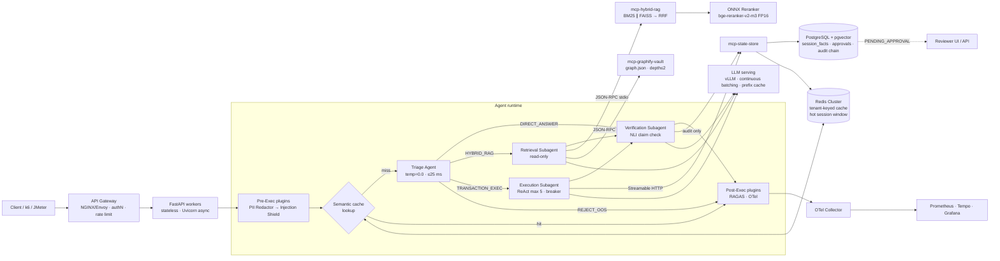

# design.md — The Unreliable Assistant → Enterprise Grade

> **Status:** LOCKED v1.0 (Gate 1) — locked 2026-11-18; open questions Q1–Q9 carried forward with the draft defaults · **Owner:** Harsh Singh · **Date:** 2026-11-18
> **Source:** `docs/Unreliable_Assistant_MidCheck_Enterprise_Blueprint_v2.docx` (Gates 0–1)
> **Rule:** No implementation code until this file is reviewed and marked **LOCKED**.

---

## 0. Context & Stack (from Gate 0)

The prototype we inherited has five known failures. Each one maps to a control in this design:

| Prototype failure | Primary control | Section |
|---|---|---|
| Hallucinated facts | 3-stage hybrid RAG, abstention short-circuit (rerank < 0.42), Verification Subagent veto | 1.2, 1.6, ADR-001 |
| Runaway tool loops | Bounded ReAct state machine (`max_iterations=5`), idempotent circuit breaker | 1.2, ADR-004 |
| Cross-user cache leaks | `SHA256(tenant_id:user_id:norm_query)` Redis keys, tenant_id in every query | ADR-003 |
| Context drift | Immutable `GoalAnchorBlock`, observation compression, sliding window | 1.3 |
| Latency collapse under load | Async FastAPI, bulkheads, ONNX quantized models, semantic cache | 1.4, ADR-002 |

| Layer | Choice | MCP / Plugin binding |
|---|---|---|
| Agent runtime & API | Python 3.11, FastAPI, Uvicorn (async) | MCP host client (`mcp.ClientSession`) |
| Sparse + dense retrieval | rank-bm25, FAISS, `bge-large-en-v1.5` (ONNX) | MCP server `mcp-hybrid-rag` (stdio) |
| Reranker | ONNX Runtime, `bge-reranker-v2-m3` FP16 | In-process / Triton microservice |
| State & cache | PostgreSQL (+pgvector), Redis Cluster | MCP server `mcp-state-store` (Streamable HTTP) |
| Token compression | Obsidian vault + Graphify graph | MCP server `mcp-graphify-vault` (stdio) |
| Lifecycle plugins | Pluggy entry-point hooks | `pii_redactor`, `injection_shield`, `circuit_breaker`, `ragas_auditor`, `otel_exporter` |

---

## 1.1 System Charter & Hard Boundaries

### Purpose
This is a multi-tenant enterprise operations assistant. It answers policy, SOP and product-catalog questions from a curated knowledge vault and grounds every answer in a citation. It can also run bounded, schema-validated workflow actions, such as batch/lot verification, form submission and status transitions, against the state store.

*Assumption:* the domain is regulated manufacturing/ops. This comes from the load-test query `Verify batch LOT-88392 safety protocol` and the `SKU-099` / `LOT-00044` identifiers. **Confirm.**

### In scope
- Grounded Q&A over `knowledge_vault/` (factoid, multi-hop, summary). Every claim is cited to a chunk.
- Deterministic abstention when the evidence is insufficient.
- Tier 1 (read) and Tier 2 (compute) tool calls run without a human.
- Tier 3 (mutate) tool calls only through the HITL approval gate.
- Strict tenant isolation, PII redaction on ingress, and a hash-chained audit trail.
- 50K concurrent VUs at p95 ≤ 450 ms and p99 ≤ 600 ms.

### Non-goals (hard boundaries)
| # | Boundary | Enforcement |
|---|---|---|
| NG-1 | **No autonomous clinical, financial or legal execution.** Any such action is Tier 3 and requires HITL. | RBAC tier check in `ToolExecutionHarness` plus a `PENDING_APPROVAL` record |
| NG-2 | No open-web browsing or external retrieval | Retrieval Subagent is bound only to `mcp-hybrid-rag` and `mcp-graphify-vault` |
| NG-3 | No answers from parametric memory when retrieval confidence is low | Abstention short-circuit |
| NG-4 | No raw PII persisted anywhere (logs, cache, Postgres, traces) | `pii_redactor` runs fail-closed at PRE_EXECUTION |
| NG-5 | No cross-tenant data access, including cache | Tenant-scoped keys and queries; KPI-28 = 0 leaks |
| NG-6 | No unbounded agent loops or recursive self-calls without a state change | State machine and circuit breaker |
| NG-7 | No model training or fine-tuning on tenant data | Out of scope |

### Personas
| Persona | Goal | Max tier |
|---|---|---|
| **Operator** (tenant end user) | Ask policy/SOP questions, verify lots/SKUs, start workflows | Tier 2; Tier 3 only as a request |
| **Reviewer** (HITL approver) | Approve or reject pending Tier 3 mutations with full context | Approves Tier 3 |
| **Tenant Admin** | Manage users, roles and vault content for one tenant | Admin within one tenant |
| **Platform Engineer** | Operate the system, read traces and KPIs, run red-team and load tests in the Streamlit workbench | No tenant data access beyond redacted traces |

---

## 1.2 MCP Tool & Data Contracts

All tools use MCP over JSON-RPC 2.0. Each call passes through `ToolExecutionHarness` in this order:
1. Pydantic v2 `strict=True` validation
2. Deterministic regex auto-repair
3. RBAC tier check
4. UUIDv4 idempotency check

### 1.2.1 Shared types & ID constraints

```python
from pydantic import BaseModel, Field, ConfigDict
from typing import Literal
from uuid import UUID

TENANT_RE = r"^tenant_[a-z0-9]{1,32}$"
USER_RE   = r"^user_[a-z0-9]{1,64}$"
SKU_RE    = r"^SKU-\d{3}$"        # repair: "SKU99"  -> "SKU-099"
LOT_RE    = r"^LOT-\d{5}$"        # repair: "lot 44" -> "LOT-00044"
CHUNK_RE  = r"^[a-f0-9]{64}$"     # sha256 chunk_hash

Tier = Literal["TIER_1_READ", "TIER_2_COMPUTE", "TIER_3_MUTATE"]

class CallContext(BaseModel):
    model_config = ConfigDict(strict=True, extra="forbid", frozen=True)
    tenant_id: str = Field(pattern=TENANT_RE)
    user_id: str = Field(pattern=USER_RE)
    session_id: UUID
    idempotency_key: UUID            # UUIDv4, required on every call
    traceparent: str = Field(pattern=r"^00-[0-9a-f]{32}-[0-9a-f]{16}-0[01]$")
```

> Open question: the blueprint's k6 script sends `LOT-88392` (5 digits), which fits `LOT_RE`. The repair example `lot 44 → LOT-00044` implies zero-padding to 5 digits. SKU looks like 3 digits. Need the real ID formats.

### 1.2.2 `mcp-hybrid-rag`

**Tool `hybrid_retrieve`** (Tier 1)
```python
class HybridRetrieveIn(BaseModel):
    model_config = ConfigDict(strict=True, extra="forbid")
    ctx: CallContext
    query: str = Field(min_length=1, max_length=2000)
    domain: str | None = Field(default=None, pattern=r"^[a-z_]{1,32}$")
    bm25_top_k: int = Field(default=50, ge=1, le=100)
    dense_top_k: int = Field(default=50, ge=1, le=100)
    rrf_k: int = Field(default=60, ge=1, le=200)
    rerank_k: int = Field(default=4, ge=1, le=10)
    min_rerank_score: float = Field(default=0.42, ge=0.0, le=1.0)

class Chunk(BaseModel):
    chunk_hash: str = Field(pattern=CHUNK_RE)
    uri: str = Field(pattern=r"^rag://chunks/[a-f0-9]{64}$")
    text: str = Field(max_length=4096)
    note_id: str                     # Obsidian frontmatter id
    bm25_score: float | None
    dense_cosine: float | None
    rrf_rank: int
    rerank_score: float              # sigmoid, 0..1

class HybridRetrieveOut(BaseModel):
    chunks: list[Chunk] = Field(max_length=10)
    top_score: float
    abstain: bool                    # True when top_score < min_rerank_score
    stage_latency_ms: dict[Literal["bm25", "dense", "rrf", "rerank"], float]
```

**Resource `rag://chunks/{chunk_hash}`** (read-only) returns `Chunk`. Tenant ACL is checked on every read.

### 1.2.3 `mcp-graphify-vault`

**Tool `graph_subgraph`** (Tier 1)
```python
class GraphSubgraphIn(BaseModel):
    model_config = ConfigDict(strict=True, extra="forbid")
    ctx: CallContext
    anchor_note_ids: list[str] = Field(min_length=1, max_length=4)
    depth: int = Field(default=2, ge=1, le=2)    # hard cap at 2 hops
    max_tokens: int = Field(default=320, ge=64, le=800)

class GraphSubgraphOut(BaseModel):
    nodes: list[dict]          # {id, domain, risk_tier, version, summary}
    edges: list[tuple[str, str, str]]   # (src, rel, dst)
    token_count: int
    raw_token_estimate: int    # for KPI-26 savings
```

### 1.2.4 `mcp-state-store`

| Tool | Tier | Input → Output |
|---|---|---|
| `get_session_facts` | 1 | `{ctx}` → `{facts: list[SessionFact]}` |
| `put_session_fact` | 2 | `{ctx, fact: SessionFact}` → `{fact_id}` (verified facts only) |
| `lookup_lot` | 1 | `{ctx, lot_id: LOT_RE}` → `{lot_id, status, protocol_ref, updated_at}` |
| `submit_transaction` | **3** | `{ctx, action: Literal[...], payload: dict, justification: str}` → `{approval_id, status: "PENDING_APPROVAL"}` |
| `get_approval` | 1 | `{ctx, approval_id}` → `{status: PENDING_APPROVAL \| APPROVED \| REJECTED, reviewer_id?, decided_at?}` |
| `append_audit` | internal | `{ctx, event: dict}` → `{seq, hash}` where `hash = SHA256(prev_hash + canonical(event))` |

```python
class SessionFact(BaseModel):
    model_config = ConfigDict(strict=True, extra="forbid")
    key: str = Field(pattern=r"^[a-z_]{1,64}$")
    value: str = Field(max_length=512)
    source_chunk_hash: str | None = Field(default=None, pattern=CHUNK_RE)
```

`submit_transaction` never executes the action. It only writes `PENDING_APPROVAL`. The action runs after a Reviewer approves, through a separate worker path.

### 1.2.5 Error codes (JSON-RPC `error.code`)

| Code | Name | Meaning | Caller behaviour |
|---|---|---|---|
| -32600 / -32601 / -32602 | (standard) | Invalid request / method / params | Auto-repair once, then fail |
| -32001 | `SCHEMA_VALIDATION_FAILED` | Pydantic strict failure after repair | Return to ReAct as an observation, counted toward the breaker |
| -32002 | `AUTO_REPAIR_FAILED` | Regex repair could not produce a valid ID | Ask the user to clarify |
| -32003 | `RBAC_DENIED` | Caller tier < tool tier | Explain the refusal; never retry |
| -32004 | `IDEMPOTENCY_REPLAY` | Key already seen | Return the cached result |
| -32005 | `TENANT_SCOPE_VIOLATION` | Resource is not owned by `ctx.tenant_id` | Hard fail plus a security audit event |
| -32006 | `HITL_REQUIRED` | Tier 3 attempted outside `submit_transaction` | Route to the HITL gate |
| -32007 | `CIRCUIT_OPEN` | Breaker tripped on `(tool, args_hash)` | `HALTED_BREAKER` and a remediation prompt |
| -32008 | `UPSTREAM_TIMEOUT` | Step exceeded its budget | Use the fallback from the FMEA |
| -32009 | `LOW_CONFIDENCE_ABSTAIN` | Rerank top score < threshold | Deterministic abstention response |
| -32010 | `PII_BLOCKED` | Unredactable PII detected | Fail closed |
| -32011 | `INJECTION_BLOCKED` | Injection classifier positive | Fail closed with a safe refusal |

### 1.2.6 Public API

`POST /api/v1/agent/query`
```json
// request
{"tenant_id": "tenant_7", "user_id": "user_123", "session_id": "uuid", "query": "string"}
// header X-Tenant-ID must equal body tenant_id, else 403
// response
{"tenant_id": "tenant_7", "trace_id": "...", "route": "HYBRID_RAG",
 "answer": "...", "citations": ["rag://chunks/<hash>"], "abstained": false,
 "status": "DONE | HALTED | HALTED_BREAKER | PENDING_APPROVAL",
 "approval_id": null, "faithfulness": 0.95}
```

---

## 1.3 Distributed Topology & Data Flow



### Request flow (happy path, HYBRID_RAG)
1. **Ingress:** the gateway authenticates and enforces `X-Tenant-ID == body.tenant_id`. It injects `traceparent`.
2. **Pre-hooks (fail-closed):** PII is redacted to placeholders, then the injection classifier runs. Only redacted text continues past this point.
3. **Cache:** key = `SHA256(tenant_id:user_id:norm_query)`. On a hit, return immediately (still audited).
4. **Triage:** classify `(intent, domain, risk_tier, complexity)` and pick one of `DIRECT_ANSWER | HYBRID_RAG | TRANSACTION_EXEC | REJECT_OOS`.
5. **Retrieval:** run `hybrid_retrieve` (BM25 and dense in parallel, then RRF, then rerank). If `abstain=true`, return the deterministic abstention and **skip the LLM**. Otherwise call `graph_subgraph` on the anchor notes.
6. **Prompt assembly:** `GoalAnchorBlock` at index 0, then the subgraph (≤320 tok), the top 4 chunks, compressed observations (≤180 tok each), and the last 3 turns.
7. **Generate:** stream from vLLM.
8. **Verify:** the NLI claim-to-chunk check runs on a separate context. An ungrounded draft is vetoed and replaced with an abstention or an extractive quote.
9. **Post-hooks:** write the cache with a jittered TTL of 300 s ± 45 s, append the audit event, export OTel spans, and score RAGAS asynchronously (sampled).

### TRANSACTION_EXEC flow
ReAct state machine: `INIT → TRIAGE → REASONING → TOOL_CALL → OBSERVATION → VERIFY → DONE | HALTED`. Every `TOOL_CALL` goes through the harness. A Tier 3 call becomes `submit_transaction`, which returns `PENDING_APPROVAL`, and the session pauses. A Reviewer decision resumes it through `get_approval`.

### Memory
- **Hot:** Redis holds the last 3 ReAct turns per `tenant:session`, with a TTL.
- **Durable:** Postgres `session_facts` holds verified facts keyed by `(tenant_id, session_id)`.
- **Anchor:** `GoalAnchorBlock` is immutable for the whole session. It holds the original intent, normalized entity IDs and policy constraints.

### Bulkheads
`rag_pool=64`, `db_pool=128`, `llm_pool=256`, with a separate pool for health checks and triage so a slow reranker cannot starve routing.

---

## 1.4 End-to-End Latency Budget (target p95 ≤ 450 ms, p99 ≤ 600 ms @ 50K VUs)

**Definition (proposed):** e2e latency is measured from gateway receipt to the **final byte for non-streamed short answers**, or to the **first token for streamed answers**. See open question Q1.

| # | Stage | Span | p95 budget (ms) | Notes |
|---|---|---|---|---|
| 1 | Gateway + auth + tenant check | `gateway` | 5 | |
| 2 | Pre-hooks (PII + injection) | `hook.pre` | 15 | KPI-01 |
| 3 | Semantic cache lookup | `cache.lookup` | 3 | A hit exits here, ~25 ms total |
| 4 | Triage classify | `triage.classify` | 25 | KPI-05 |
| 5 | BM25 ∥ Bi-encoder+FAISS | `mcp.rag.bm25` / `mcp.rag.biencoder` | 25 | Parallel; max(12, 25). KPI-07/08 |
| 6 | RRF fusion | `mcp.rag.rrf` | 3 | |
| 7 | Cross-encoder rerank | `mcp.rag.rerank` | 45 | KPI-09; dynamic batch 32, max_wait 8 ms |
| 8 | Graphify subgraph | `mcp.graphify` | 10 | Precomputed `graph.json` |
| 9 | MCP serialization (×3 calls) | `mcp.client` | 12 | KPI-30: ≤4 ms each |
| 10 | Prompt assembly + compression | `agent.prompt` | 5 | |
| 11 | LLM TTFT | `llm.generate` | 180 | KPI-25 |
| 12 | Verification (NLI) | `verify.nli` | 40 | Runs on the streamed draft; see Q2 |
| 13 | Post-hooks (sync part) + egress | `hook.post` | 7 | RAGAS is **async**, off the critical path |
| | **Subtotal** | | **375** | |
| | **Headroom (GC, queueing, network jitter)** | | **75** | |
| | **p95 total** | | **450** | ✅ meets KPI-32 |
| | **p99 allowance** | | **≤ 590** | KPI-33; tail covered by bulkheads and timeouts |

**Fast paths**
- Cache hit: about 1 + 2 + 3 + egress ≈ **25 ms**.
- Abstention short-circuit: 1–7 + egress ≈ **≤ 90 ms** (no LLM).
- These two paths pull p50 toward the ≤ 240 ms target (KPI-31). That needs a cache hit ratio of at least 35% (KPI-27).

**Degradation levers** (automated when p95 > 550 ms for 30 s)
- Lower the cache cosine threshold to 0.92.
- Cut `top_k` from 50 to 25.
- Drop the Graphify call for low-complexity queries.

---

## 1.5 KPI & SLA Gate Matrix (36 KPIs)

Every KPI is a hard release gate. **Fail = block release.** All are measured in CI and shown in Workbench Tab 6.

| ID | Stage | KPI | Pass threshold | Source |
|---|---|---|---|---|
| KPI-01 | Ingress & Triage | Pre-hook guardrail latency p95 | ≤ 15 ms | OTel `hook.pre` |
| KPI-02 | Ingress & Triage | PII redaction recall (email/phone/SSN/obfuscated) | ≥ 99.8% | Presidio/regex audit |
| KPI-03 | Ingress & Triage | Prompt-injection block rate (direct + indirect) | ≥ 99.5% | Red-team benchmark |
| KPI-04 | Ingress & Triage | Triage routing accuracy | ≥ 97.0% | Labeled intent set |
| KPI-05 | Ingress & Triage | Triage latency p95 | ≤ 25 ms | OTel `triage` |
| KPI-06 | Ingress & Triage | False-positive refusal on benign queries | ≤ 1.0% | Benign control set |
| KPI-07 | Hybrid Retrieval | BM25 latency p95 | ≤ 12 ms | OTel `rag.bm25` |
| KPI-08 | Hybrid Retrieval | Bi-encoder + FAISS latency p95 | ≤ 25 ms | OTel `rag.dense` |
| KPI-09 | Hybrid Retrieval | Cross-encoder rerank latency p95 | ≤ 45 ms | OTel `rag.rerank` |
| KPI-10 | Hybrid Retrieval | Hybrid context recall@50 | ≥ 0.92 | RAGAS / IR eval |
| KPI-11 | Hybrid Retrieval | Post-rerank context precision@4 | ≥ 0.88 | RAGAS |
| KPI-12 | Hybrid Retrieval | MRR@4 | ≥ 0.85 | IR script |
| KPI-13 | Hybrid Retrieval | nDCG@4 | ≥ 0.86 | IR script |
| KPI-14 | Agent & Loop | Tool schema first-pass validation rate | ≥ 96.0% | Pydantic telemetry |
| KPI-15 | Agent & Loop | Auto-repair success on malformed args | ≥ 90.0% | Harness metrics |
| KPI-16 | Agent & Loop | Infinite-loop escape rate | 100.0% | Chaos loop suite |
| KPI-17 | Agent & Loop | Mean ReAct steps per completed task | ≤ 2.2 | OTel trace count |
| KPI-18 | Agent & Loop | Context drift (goal cosine alignment) | ≥ 0.85 | Embedding drift audit |
| KPI-19 | Agent & Loop | Tier 3 HITL enforcement | 100.0% | Audit log integrity |
| KPI-20 | Generation | RAGAS faithfulness | ≥ 0.92 | Post-hook RAGAS |
| KPI-21 | Generation | RAGAS answer relevancy | ≥ 0.90 | Post-hook RAGAS |
| KPI-22 | Generation | RAGAS context entity recall | ≥ 0.85 | Post-hook RAGAS |
| KPI-23 | Generation | Unanswerable-query abstention accuracy | ≥ 98.0% | Negative test set |
| KPI-24 | Generation | Unsupported claim / hallucination rate | ≤ 0.5% | NLI verifier |
| KPI-25 | Generation | TTFT p95 | ≤ 180 ms | FastAPI stream metric |
| KPI-26 | Token & Graphify | Prompt token reduction | ≥ 45.0% | Token counter hook |
| KPI-27 | Token & Graphify | Semantic cache hit ratio (steady state) | ≥ 35.0% | Redis hit/miss |
| KPI-28 | Token & Graphify | Cross-tenant cache isolation | 100% (0 leaks) | Concurrency probe |
| KPI-29 | Token & Graphify | Cost per 1,000 queries | ≤ $0.45 | OTel token cost |
| KPI-30 | Token & Graphify | MCP JSON-RPC serialization overhead p95 | ≤ 4 ms | MCP client timer |
| KPI-31 | Scale & Load | E2E latency p50 @ 50K VUs | ≤ 240 ms | k6 + JMeter |
| KPI-32 | Scale & Load | E2E latency p95 @ 50K VUs | ≤ 450 ms | k6 + JMeter |
| KPI-33 | Scale & Load | E2E latency p99 @ 50K VUs | ≤ 590 ms | k6 + JMeter |
| KPI-34 | Scale & Load | HTTP 5xx rate @ 50K VUs | ≤ 0.05% | k6 / JMeter |
| KPI-35 | Scale & Load | Sustained throughput | ≥ 8,500 RPS | k6 / JMeter |
| KPI-36 | Scale & Load | RSS growth over 1 h soak | ≤ 3.0% | Prometheus node exporter |

**Gate policy**
- **Blocking:** any safety KPI (02, 03, 16, 19, 24, 28) below threshold blocks the release, with no waiver.
- **Waivable:** other KPIs need a written waiver ADR to ship.

---

## 1.6 Failure Mode & Effects Analysis (FMEA)

S = severity, O = occurrence, D = detection difficulty, each scored 1–10. RPN = S×O×D.

| # | Component / Failure | Effect | S | O | D | RPN | Detection | Deterministic fallback |
|---|---|---|---|---|---|---|---|---|
| 1 | **Redis down / unreachable** | No cache, no hot session window | 6 | 3 | 2 | 36 | Health probe, connection errors | Bypass the cache (treat as a miss). Rebuild the window from Postgres `session_facts`. Shed load if p95 > 550 ms |
| 2 | **Reranker timeout** (> 45 ms ×2) | No precision ranking | 7 | 4 | 2 | 56 | `rag.rerank` span timeout | Use the RRF top 4 with a stricter abstention (the RRF score must clear a calibrated cutoff), flag `degraded=true` |
| 3 | **`mcp-hybrid-rag` crash / hang** (> 150 ms) | No retrieval | 8 | 3 | 2 | 48 | JSON-RPC timeout rate > 1% | Trip the bulkhead breaker, fail over to the cached read-replica index, restart the worker. If both fail, **abstain** (never answer ungrounded) |
| 4 | **LLM 429 / rate limit** | No generation | 7 | 5 | 1 | 35 | HTTP 429 from vLLM/provider | One jittered retry within budget, then an extractive answer (quote the top chunk with a citation), else abstain |
| 5 | **LLM 5xx / timeout** | No generation | 7 | 3 | 1 | 21 | Span error | Same as #4 |
| 6 | **Postgres down** | No audit, facts or HITL | 9 | 2 | 2 | 36 | Pool errors | Read-only mode: Tier 1 continues with audit buffered to a local WAL. **Tier 2/3 rejected** with `UPSTREAM_TIMEOUT`, because an unaudited write is not allowed |
| 7 | **`mcp-graphify-vault` failure** | Larger prompts, cost up | 3 | 3 | 2 | 18 | Span error | Skip the subgraph and use only the top 4 chunks (still grounded) |
| 8 | **`mcp-state-store` failure** | No tool execution | 7 | 3 | 2 | 42 | Streamable-HTTP errors | `TRANSACTION_EXEC` returns a structured "try later" message. Retrieval routes are unaffected |
| 9 | **Triage misroute / low confidence** | Wrong subagent | 6 | 4 | 5 | 120 | Confidence < 0.7, KPI-04 drift | Default to `HYBRID_RAG` (the safest read-only route). Never default to `TRANSACTION_EXEC` |
| 10 | **Runaway tool loop** | Latency and cost blow-up | 8 | 5 | 2 | 80 | Same `(tool, args_hash)` fails twice, or 5 iterations reached | `HALTED_BREAKER` with a remediation prompt |
| 11 | **PII / injection classifier failure** | Leak or jailbreak risk | 10 | 2 | 4 | 80 | Plugin exception or timeout | **Fail closed**: reject the request with a safe refusal |
| 12 | **Cross-tenant cache key collision** | Data leak | 10 | 1 | 6 | 60 | Concurrency probe, response tenant_id ≠ request tenant_id | Response tenant check at egress blocks the response and purges the key. An alert pages on-call |
| 13 | **Verifier (NLI) timeout** | Ungrounded draft could leak | 8 | 3 | 2 | 48 | Span timeout | Do not release the free-form draft; return an extractive quote or abstain |
| 14 | **HITL reviewer never responds** | Tier 3 stuck | 4 | 5 | 1 | 20 | `PENDING_APPROVAL` age > SLA | Expire to `REJECTED` after the TTL (proposed 24 h), notify the requester. Never auto-approve |

The blueprint asks for 12 rows; this draft has 14. Rows 13–14 are additions and can be dropped.

**Highest RPN:**
- Triage misroute (#9). Mitigated by the safe-default rule and KPI-04 monitoring.
- Loops and guardrail failure (#10, #11).

---

## 1.7 Architecture Decision Records

### ADR-001 — Hybrid retrieval: BM25 ∥ Dense → RRF (k=60) → Cross-encoder
- **Context:** Pure dense retrieval misses exact identifiers such as `LOT-00044`, `SKU-099` and policy codes. Pure BM25 misses paraphrases. The prototype hallucinated when retrieval was weak.
- **Decision:**
  - Run BM25 (k1 = 1.25, b = 0.75, top 50) and the bi-encoder (`bge-large-en-v1.5`, top 50) in parallel.
  - Fuse with RRF at k = 60, deduplicate by `chunk_hash`, and keep a pool of 40.
  - Rerank with the cross-encoder down to the top 4, using a sigmoid cutoff of 0.42.
  - RRF uses **equal weights** (rank-based, so it needs no score normalization).
- **Why RRF over a weighted score sum:** BM25 and cosine scores sit on different scales. RRF needs no calibration and is robust to that.
- **Consequences:**
  - About 73 ms of retrieval on the critical path.
  - The cross-encoder threshold doubles as the abstention trigger.
  - Weights and the threshold must be tuned on the 250-question golden set before lock. If ID-heavy queries underperform, revisit with a weighted RRF, e.g. BM25 weight 1.2.
- **Rejected:**
  - Dense-only (ID recall).
  - ColBERT late interaction (memory cost at 50K VUs).

### ADR-002 — ONNX Runtime with FP16 reranker / INT8 bi-encoder, dynamic batching
- **Context:** The cross-encoder must run in ≤ 45 ms p95 at about 8.5K RPS.
- **Decision:**
  - Export both encoders to ONNX.
  - Run the reranker in FP16 on GPU.
  - Run the bi-encoder in INT8 when it runs on CPU.
  - Use dynamic micro-batching with batch = 32 and max_wait = 8 ms.
- **Consequences:**
  - Expected accuracy loss is ≤ 1 pt nDCG. It must be measured against FP32 on the golden set; reject quantization if KPI-13 drops below 0.86.
  - `max_wait` adds up to 8 ms, which the 45 ms budget already includes.
- **Rejected:**
  - PyTorch eager (latency).
  - A hosted rerank API (network hop, cost, data residency).

### ADR-003 — Redis key isolation: `SHA256(tenant_id:user_id:norm_query)` + jittered TTL
- **Context:** The prototype leaked answers across users through a shared cache.
- **Decision:**
  - Key format: `cache:{tenant_id}:` + `SHA256(tenant_id:user_id:norm_query)`.
  - The tenant prefix is also the Redis Cluster hash tag, which gives per-tenant eviction and metrics.
  - TTL is 300 s ± 45 s of jitter to prevent stampedes.
  - Egress re-checks the response `tenant_id`.
  - **The semantic (embedding-similarity) cache searches only within a tenant's own prefix.**
- **Consequences:**
  - Including `user_id` lowers the hit ratio, which puts KPI-27 (≥ 35%) at risk. Open question Q3: allow a tenant-level (not user-level) cache for Tier 1, non-personalized answers only?
- **Rejected:**
  - A global semantic cache (leak risk).
  - No cache (cannot meet p50).

### ADR-004 — Bounded ReAct loop as an explicit state machine
- **Context:** The prototype had runaway tool loops.
- **Decision:**
  - States: `INIT → TRIAGE → REASONING → TOOL_CALL → OBSERVATION → VERIFY → DONE | HALTED | HALTED_BREAKER`.
  - Limits: `max_iterations = 5` and `total_loop_budget = 450 ms`.
  - Breaker: trips when the same `(tool_name, canonical_args_hash)` fails twice.
  - No transition back to `REASONING` without a state change (new observation hash).
  - Every observation is compressed to ≤ 180 tokens.
- **Consequences:**
  - Some genuinely long tasks will halt. They get a structured "here's what I did, what's next" response instead of a hang.
  - KPI-17 (≤ 2.2 mean steps) pushes prompts toward single-shot tool use.
- **Rejected:**
  - Unbounded LangChain-style agents.
  - Pure plan-and-execute (higher latency for simple tasks).

### ADR-005 — MCP transports: stdio for co-located servers, Streamable HTTP for state-store
- **Decision:** Run `hybrid-rag` and `graphify-vault` as stdio children of each API worker. They are read-only with immutable indices, and stdio avoids network serialization (KPI-30). `state-store` is a shared, stateful service over Streamable HTTP with `pool_size=200`.
- **Consequences:**
  - The index is duplicated in memory per worker host.
  - FAISS-IVF-PQ keeps that footprint small. This also resolves the Gate 0 (IVF-PQ) versus Gate 3 (HNSW) mismatch in favour of IVF-PQ for memory. Confirm (Q4).

---

## Open Questions (need decisions before LOCK)

| # | Question | Why it matters |
|---|---|---|
| Q1 | Is "end-to-end latency" measured to the first token or to the full response? A full LLM answer will not fit in 450 ms; TTFT alone is 180 ms. | It decides whether 1.4 is feasible |
| Q2 | The verifier must check the claims before release, but streaming sends tokens before the check. Do we buffer (adds latency) or stream with a retraction? | Faithfulness versus TTFT |
| Q3 | Is a tenant-level cache acceptable for non-personalized Tier 1 answers? | KPI-27 hit ratio versus isolation |
| Q4 | FAISS index type: IVF-PQ (Gate 0) or HNSW (Gate 3)? | Memory versus recall |
| Q5 | `per_step_timeout = 120 ms` (Gate 4) is less than LLM TTFT of 180 ms. Should the LLM step get its own budget? | The loop would always time out |
| Q6 | Triage budget: < 30 ms (Gate 2) or ≤ 25 ms (Gates 6 and 12)? This draft uses 25. | Consistency |
| Q7 | Persistence: the blueprint mentions both SQLite and Postgres. This draft uses Postgres only, with SQLite for local dev. | Simplicity |
| Q8 | Real domain and ID formats (LOT/SKU digit counts) | Regex contracts in 1.2 |
| Q9 | Which LLM (model, self-hosted vLLM or API)? It drives KPI-25 and KPI-29. | Cost and latency |

---

## Lock checklist
- [x] 1.1 Charter reviewed
- [x] 1.2 Contracts reviewed (schemas freeze into `contracts/`)
- [x] 1.3 Topology reviewed
- [x] 1.4 Budget accepted (Q1, Q2, Q5 resolved)
- [x] 1.5 KPI matrix accepted
- [x] 1.6 FMEA reviewed
- [x] 1.7 ADRs accepted
- [x] Status changed to **LOCKED**, then Gate 2 (`docs/workflow_orchestration.png`) may start
